# Portofolio 2026

## Table of Content
#### A.  [Portofolio 2026](#portofolio-2026)
  1. [Financial Performance Dashboard](#financial-performance-dashboard)
  2. [Financial Performance Dashboard UPDATE](#financial-performance-dashboard-power-bi-update)
  3. [HR Analytics Dashboard](#hr-analytics-dashboard)
  4. [HR Analytics Dashboard + Monthly Paginated Report UPDATE](#hr-analytics-dashboard--monthly-paginated-report-power-bi-update)
  5. [Marketing Analytics Dashboard](#marketing-analytics-dashboard)
#### B. [Portofolio 2025](#portofolio-2025)
  5. [Google ADS (Google ADS)](#google-ads-google-ads)
  6. [Pizza Sales Performance & Customer Insight Dashboard (Pizza Analyst)](#interactive-pizza-sales-performance--customer-insight-dashboard-pizza-analyst)
  7. [Look Ecommerce Performance & Customer Insight Dashboard (Look Ecommece)](#interactive-look-e-commerce-performance--customer-insight-dashboard-look-ecommece)
  8. [Executive Business Intelligence & Sales Analytics Suite (sales E-Commmerce)](#interactive-executive-business-intelligence--sales-analytics-suite-sales-e-commmerce)
  9. [Executive Business Intelligence & Advanced Sales Analytics Suite (Sales Report)](#interactive-executive-business-intelligence--advanced-sales-analytics-suite-sales-report)
  10. [Multi-Industry BI Dashboards & Executive Analytics (Brazzilan E-Commerce)](#interactive-multi-industry-bi-dashboards--executive-analytics-brazzilan-e-commerce)

## Financial Performance Dashboard

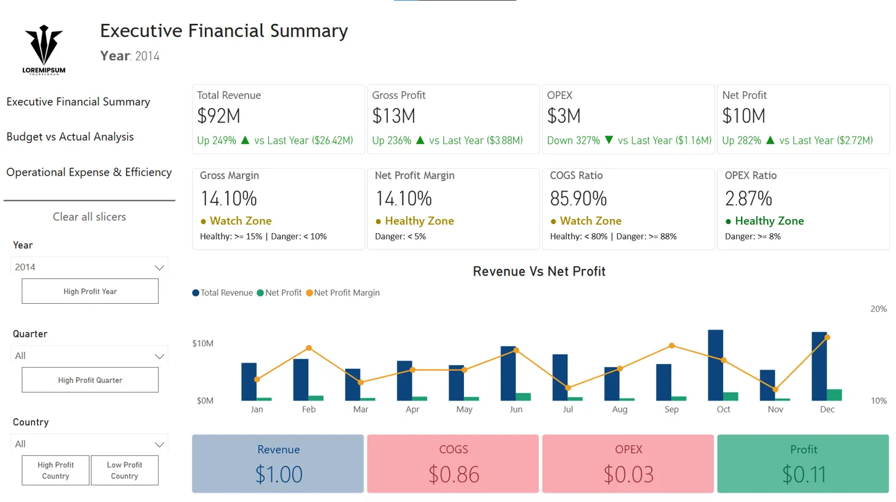
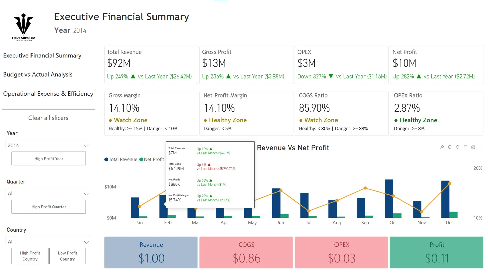
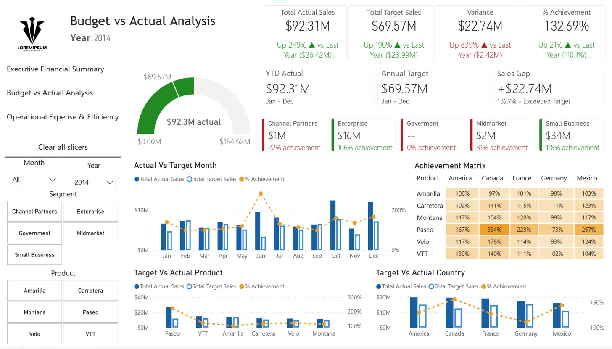
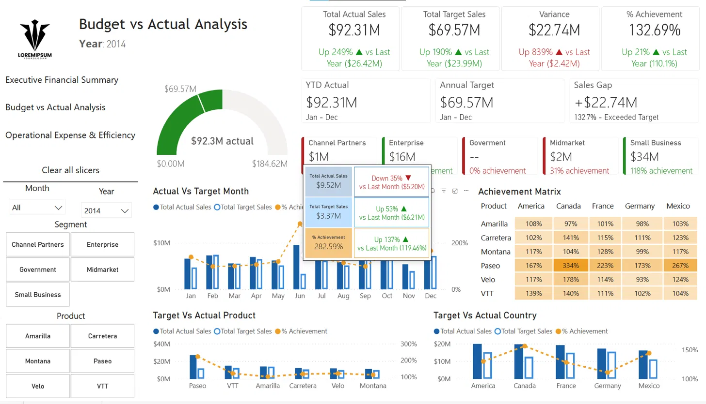
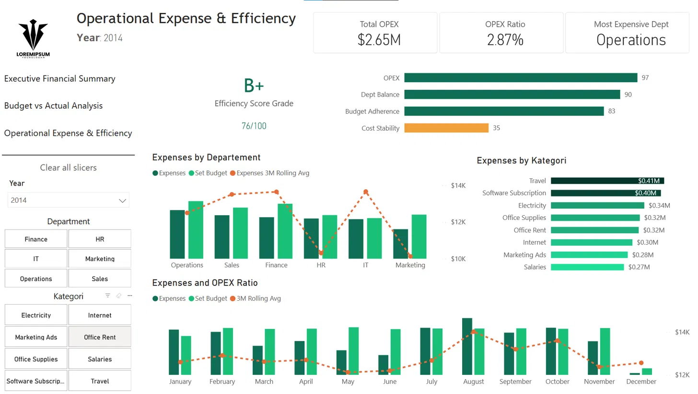
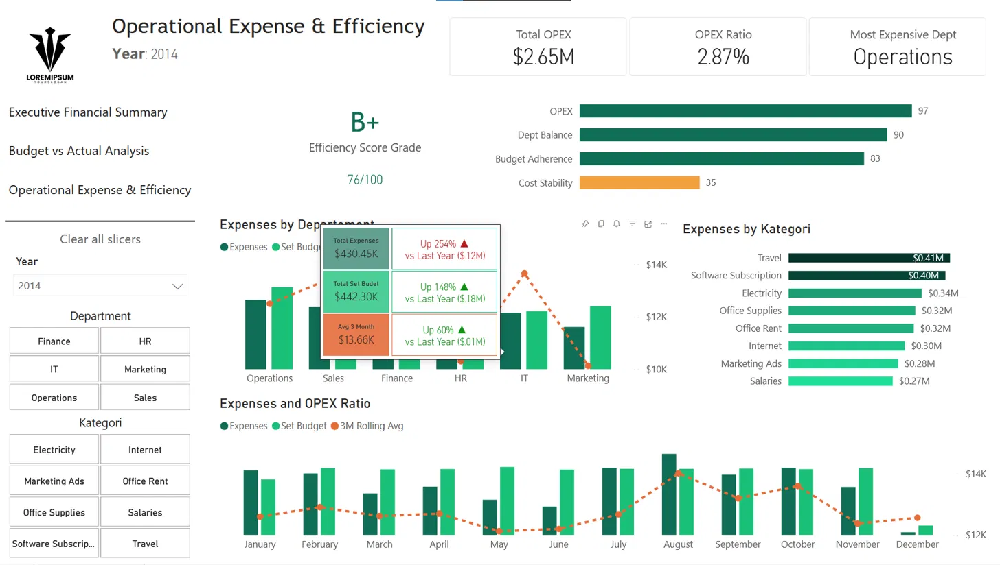

3-page Power BI financial analytics dashboard covering Executive Financial Summary, Budget vs Actual Analysis, and Operational Expense & Efficiency
Key highlight: custom rich tooltips on every chart displaying detailed metrics (MoM change, vs Last Year comparison) without cluttering the main canvas
Interactive slicers for Year, Quarter, Month, Country, Segment, Department, and Product category

Dashboard Pages

- Executive Financial Summary — KPI cards with health zone indicators (Healthy/Watch/Danger), Revenue vs Net Profit trend, and cost breakdown ratio (Revenue $1 → COGS $0.86 → OPEX $0.03 → Profit $0.11)
- Budget vs Actual Analysis — YTD gauge chart, achievement rate by segment and product, Achievement Matrix heatmap across 5 countries and 6 products, actual vs target by month/product/country
- Operational Expense & Efficiency — Efficiency Score Grade (B+ / 76/100), OPEX breakdown by department and category, 3-month rolling average trend, budget adherence scoring

Tooltip Feature

- Every visual includes custom tooltips surfacing contextual detail: current value, % change vs last month, and % change vs last year — enabling drill-down insight without page navigation

## Financial Performance Dashboard (Power BI) UPDATE

A three-page Power BI dashboard for finance: executive KPIs with health zones, budget vs actual tracking, and operating expense (OPEX) efficiency. It is built to answer three questions quickly: *How profitable are we? Are we hitting target? Are costs under control?*

> **Data:** sample financial dataset (sales by segment, product and country, plus OPEX, budget and target tables). All figures are illustrative.

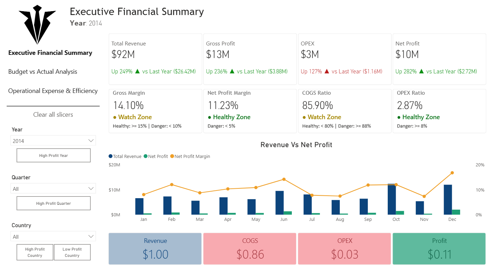

---

### Contents

- [Dashboard pages](#dashboard-pages)
- [Data model](#data-model)
- [Advanced DAX highlights](#advanced-dax-highlights)
- [What changed in this revision](#what-changed-in-this-revision)
- [Known limitations](#known-limitations)
- [Tools](#tools)

---

### Dashboard pages

| Page | What it answers | Main components |
|---|---|---|
| **Executive Financial Summary** | How profitable is the business, and is it healthy? | KPI cards with prior-year (PY) comparison: revenue, gross profit, OPEX, net profit. Ratio cards with health zones: gross margin, net profit margin, COGS ratio, OPEX ratio. Revenue vs net profit trend with margin line. "Per $1 of revenue" cost breakdown |
| **Budget vs Actual Analysis** | Are we meeting target, and where do we miss it? | Actual, target, variance and % achievement with PY comparison. Gauge against target. Achievement by segment. Actual vs target by month, product and country. Achievement heatmap (product × country) |
| **Operational Expense & Efficiency** | Are costs controlled and well distributed? | Total OPEX, OPEX ratio, most expensive department. Efficiency score and grade with its four components. Expenses vs budget by department, expenses by category, monthly expenses vs budget with OPEX ratio |

**Interaction:** slicers for year, quarter, country, month, segment, product, department and category; quick-select buttons for high-profit year, high-profit quarter and high/low-profit country; custom report-page tooltips showing month-over-month or year-over-year change on hover; page menu with active-page highlight.

| | |
|---|---|
| 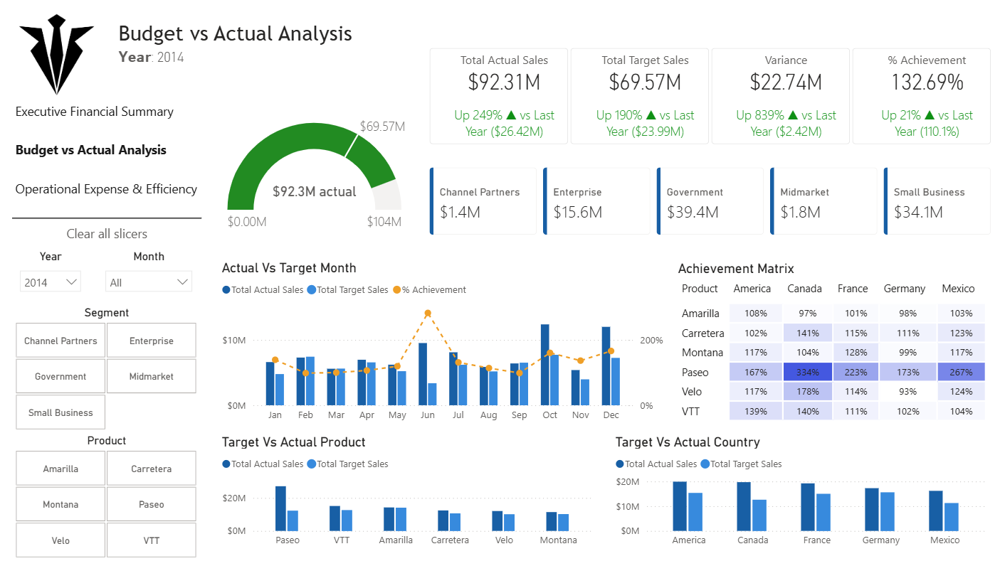 | 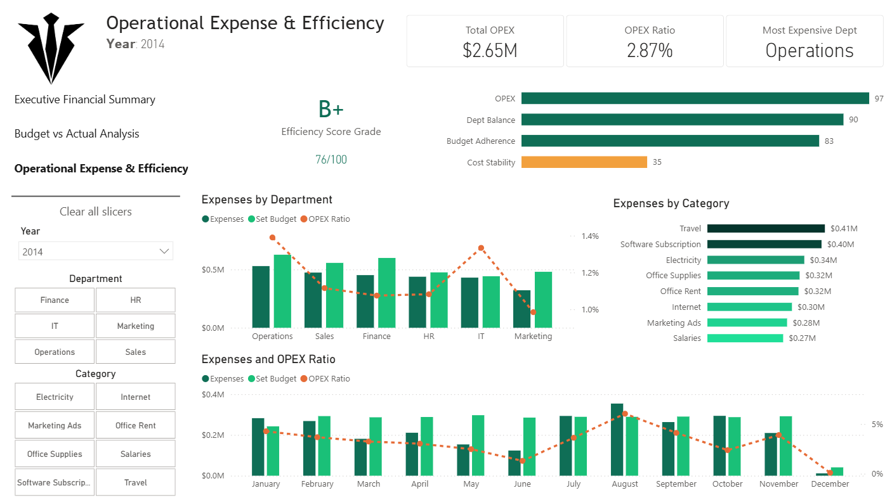 |

---

### Data model
Financial_Dashboard/content/finance-dashboard-relasi-table.png)

- **Fact tables:** `sales` (sales, COGS, discounts, gross sales) and `operasional` (operating expenses).
- **Plan tables:** `target` (sales targets by month, product and country) and `anggaranOPEX` (OPEX budget by department and month).
- **Dimension and helper tables:** `_DATE` (shared calendar with calculated profit-category columns), `Scenario Table` and `Slicer_Rentang` (helper tables for slicer logic).

---

### Advanced DAX highlights
 
Status labels, comparison periods, health thresholds and the efficiency grade are all calculated in DAX, so every card updates with the slicers and explains itself.
 
| Technique | Where it is used |
|---|---|
| `ISFILTERED` to detect the active filter context | Switching comparison period and thresholds between quarter and year |
| `SWITCH ( TRUE (), ... )` | Health zones, period labels, letter grades |
| Variables (`VAR` / `RETURN`) | Readable intermediate values in every status measure |
| `DIVIDE` with `ABS` | Growth that stays valid when the prior-period profit is zero or negative |
| `FORMAT` + `UNICHAR` | Ready-to-display text KPI, for example "Up 282% ▲ vs Last Year ($2.72M)" |
| Calculated columns on `_DATE` | `Kategori Profit Tahun` and `Kategori Profit Quarter` for the high-profit quick-select buttons |
| Weighted composite score | Efficiency score and letter grade |
 
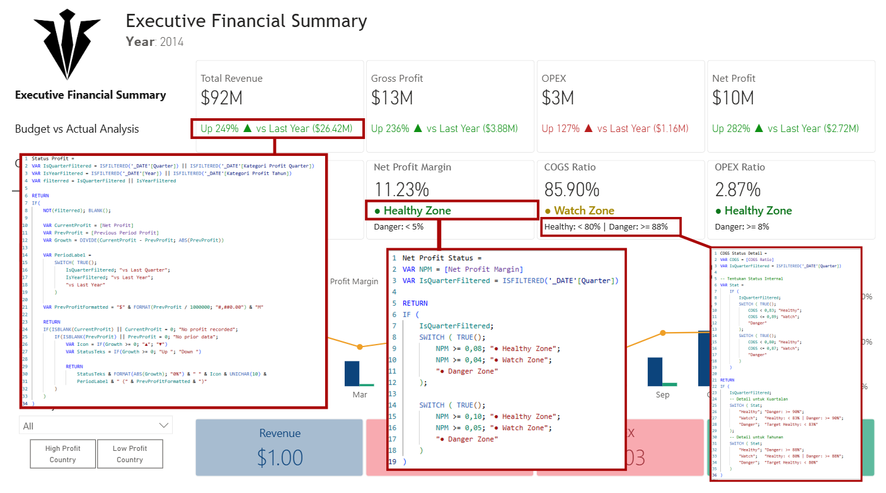
 
#### 1. Dynamic period comparison label: `Status Profit`
 
Detects whether a quarter or a year is in context (including the high-profit quarter and year selections), returns blank when no period is selected, and builds the full KPI text: direction, percentage, arrow, comparison period and the previous value in $M. Growth is divided by `ABS` of the previous value so a negative prior-period profit does not flip the sign, and edge cases return a clear message ("No profit recorded", "No prior data") instead of an error.
 
```DAX
Status Profit =
VAR _IsQuarterFiltered =
    ISFILTERED ( '_DATE'[Quarter] ) || ISFILTERED ( '_DATE'[Kategori Profit Quarter] )
VAR _IsYearFiltered =
    ISFILTERED ( '_DATE'[Year] ) || ISFILTERED ( '_DATE'[Kategori Profit Tahun] )
VAR _Filtered = _IsQuarterFiltered || _IsYearFiltered
RETURN
IF (
    NOT ( _Filtered ),
    BLANK (),
    VAR _CurrentProfit = [Net Profit]
    VAR _PrevProfit    = [Previous Period Profit]
    VAR _Growth        = DIVIDE ( _CurrentProfit - _PrevProfit, ABS ( _PrevProfit ) )
    VAR _PeriodLabel   =
        SWITCH ( TRUE (),
            _IsQuarterFiltered, "vs Last Quarter",
            _IsYearFiltered,    "vs Last Year",
            "vs Last Year" )
    VAR _PrevFormatted = "$" & FORMAT ( _PrevProfit / 1000000, "#,##0.00" ) & "M"
    RETURN
        IF (
            ISBLANK ( _CurrentProfit ) || _CurrentProfit = 0,
            "No profit recorded",
            IF (
                ISBLANK ( _PrevProfit ) || _PrevProfit = 0,
                "No prior data",
                VAR _Icon = IF ( _Growth >= 0, "▲", "▼" )
                VAR _Text = IF ( _Growth >= 0, "Up ", "Down " )
                RETURN
                    _Text & FORMAT ( ABS ( _Growth ), "0%" ) & " " & _Icon & UNICHAR ( 10 )
                        & _PeriodLabel & " (" & _PrevFormatted & ")"
            )
        )
)
```
 
#### 2. Health zones with thresholds that follow the filter: `Net Profit Status`
 
The same margin is judged against different limits depending on the period: stricter yearly limits when no quarter is selected, and quarterly limits when a quarter is filtered.
 
```DAX
Net Profit Status =
VAR _NPM = [Net Profit Margin]
VAR _IsQuarterFiltered = ISFILTERED ( '_DATE'[Quarter] )
RETURN
IF (
    _IsQuarterFiltered,
    SWITCH ( TRUE (),
        _NPM >= 0.08, "● Healthy Zone",
        _NPM >= 0.04, "● Watch Zone",
        "● Danger Zone" ),
    SWITCH ( TRUE (),
        _NPM >= 0.10, "● Healthy Zone",
        _NPM >= 0.05, "● Watch Zone",
        "● Danger Zone" )
)
```
 
#### 3. Threshold hint that changes with the status: `COGS Status Detail`
 
The status is calculated internally first, then the hint text under the card depends on it: a healthy ratio shows only the danger limit, a "watch" ratio shows both limits, and a danger ratio shows the target needed to get back to healthy. Quarterly and yearly filters use different limits.
 
```DAX
COGS Status Detail =
VAR _COGS = [COGS Ratio]
VAR _IsQuarterFiltered = ISFILTERED ( '_DATE'[Quarter] )
-- Internal status (quarterly vs yearly thresholds)
VAR _Status =
    IF (
        _IsQuarterFiltered,
        SWITCH ( TRUE (),
            _COGS < 0.83,  "Healthy",
            _COGS <= 0.89, "Watch",
            "Danger" ),
        SWITCH ( TRUE (),
            _COGS < 0.80,  "Healthy",
            _COGS <= 0.87, "Watch",
            "Danger" )
    )
RETURN
IF (
    _IsQuarterFiltered,
    -- Quarterly detail
    SWITCH ( _Status,
        "Healthy", "Danger: >= 90%",
        "Watch",   "Healthy: < 83% | Danger: >= 90%",
        "Danger",  "Target Healthy: < 83%" ),
    -- Yearly detail
    SWITCH ( _Status,
        "Healthy", "Danger: >= 88%",
        "Watch",   "Healthy: < 80% | Danger: >= 88%",
        "Danger",  "Target Healthy: < 80%" )
)
```
 
#### 4. Composite efficiency score and grade
 
Four component scores (OPEX, cost stability, department balance, budget adherence) are combined with an explicit, easy-to-change weight and converted into a letter grade. In the dashboard the components score 97, 90, 83 and 35, which gives 76/100 and a grade of **B+**. The weakest component (cost stability) is highlighted so the grade is actionable rather than just a number.
 
```DAX
Efficiency Score =
VAR _Weight = 0.25
RETURN
    ( [OPEX Score] * _Weight )
        + ( [Cost Stability Score] * _Weight )
        + ( [Dept Balance Score] * _Weight )
        + ( [Budget Adherence Score] * _Weight )
 
Efficiency Score Grade =
VAR _Score = [Efficiency Score]
RETURN
    SWITCH ( TRUE (),
        _Score >= 90, "A",
        _Score >= 80, "A-",
        _Score >= 75, "B+",
        _Score >= 70, "B",
        _Score >= 60, "C",
        "D" )
```
 
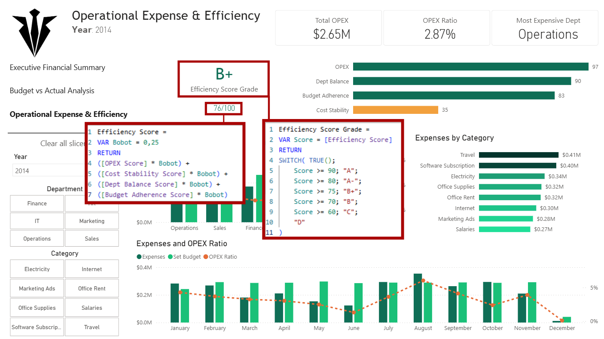
 
> Snippets are simplified: variable names are in English and separators are standardised. Measure and column names follow the model and may differ slightly from the .pbix.
 
**Reconciliation checks used while validating:**
 
- Gross profit − OPEX = net profit (≈ $13.0M − $2.65M ≈ $10.4M; PY: $3.88M − $1.16M = $2.72M).
- Net margin 11.23% matches "Profit $0.11 per $1 of revenue" on the same page.
- Segment actuals add up to total actual sales ($92.3M).
- OPEX by category adds up to total OPEX ($2.65M); revenue, OPEX and OPEX ratio are identical on every page.
- Efficiency score equals the average of its four components (97, 90, 83, 35 → 76).
---

### What changed in this revision

#### 1. Metric logic

| Area | Before | After |
|---|---|---|
| **Net profit margin** | Showed **14.10%**, identical to gross margin (calculated from gross profit) | **11.23%** = net profit ÷ revenue, consistent with $0.11 per $1 |
| **OPEX vs last year** | "Down 327%" in green, although OPEX rose from $1.16M to $2.65M | "**Up 127%**" in red |
| **Government segment** | Showed "--" and 0% achievement, hiding about $39M of sales | **$39.4M, 98%** achievement |
| **Segment cards** | Typo "Goverment" | Fixed; segment actuals now add up to $92.3M |
| **Monthly tooltip (Budget vs Actual)** | Actual and target comparisons swapped between rows (for example, actual compared with last month's target) | Each row compares with its own prior-month value |
| **Variance KPI** | "Up 839%" shown in red even though exceeding target is favourable | Green |
| **Expense tooltip (department)** | Month-level values compared with a full-year total | Department tooltips compare like with like (expenses and budget vs last year); the monthly tooltip that used the wrong base was removed |
| **Avg 3-month delta** | Increase in a cost shown in green | Cost increases shown in red, decreases in green |

#### 2. Charts

| Area | Before | After |
|---|---|---|
| **Budget gauge** | Maximum $184.62M (2× actual), so the arc looked half-empty although target was exceeded | Maximum **$104M** (150% of target) |
| **Achievement line** | Connected products and countries with a line, implying a trend | Removed; plain bars with target comparison |
| **Rolling average** | 3-month rolling average plotted across departments | Removed from the department chart |
| **OPEX chart** | Titled "Expenses and OPEX Ratio" but showed a rolling average on an unlabeled axis | Shows **OPEX ratio** with a labeled axis (0–5%) and bars on a visible $0–$0.4M axis |
| **Margin trend axis** | Started at 10%, exaggerating swings | Starts at 0% |
| **Achievement heatmap** | Orange scale, inconsistent with the blue theme | Blue scale |

#### 3. Layout and labels

| Area | Before | After |
|---|---|---|
| **KPI rows** | Second row (YTD actual, annual target, sales gap) repeated the first | Duplicate row removed, charts moved up |
| **Menu** | No indication of the current page | Active page highlighted |
| **Labels** | "Categori", "Departement" | Corrected to "Category" and "Department" |
| **Health zone colours** | "Healthy" shown in the same amber as "Watch" on one card | Healthy shown in green |
| **Tooltip formatting** | Mixed units ($7M, $6.149M, "$.13M", "($M)") | Consistent currency format |
| **Branding** | Placeholder logo text | Placeholder text removed |

---

### Known limitations

- **Sample data.** Prior-year comparisons are large (for example, revenue +249%) because the prior-year total in the sample is much smaller; treat them as illustrative.
- **June target** is unusually low ($3.37M), which produces a ~283% achievement spike for that month.
- **December expenses** are very low in the sample data, so the last bar looks almost empty.

---

### Tools

Power BI Desktop, DAX, Power Query, custom report-page tooltips, bookmarks and buttons.

## HR Analytics Dashboard
Overview
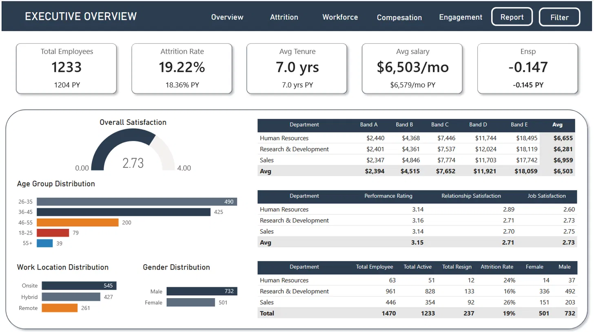
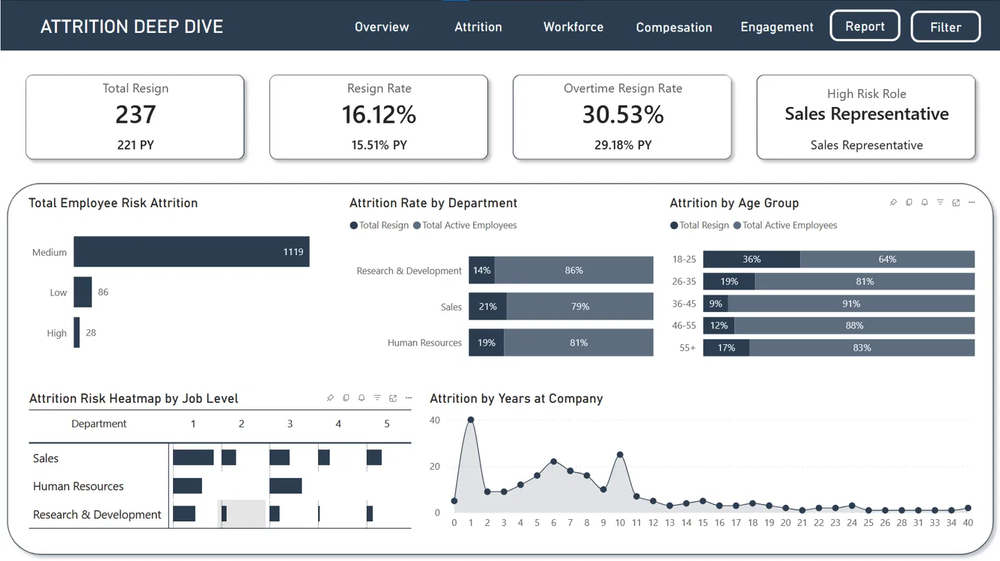
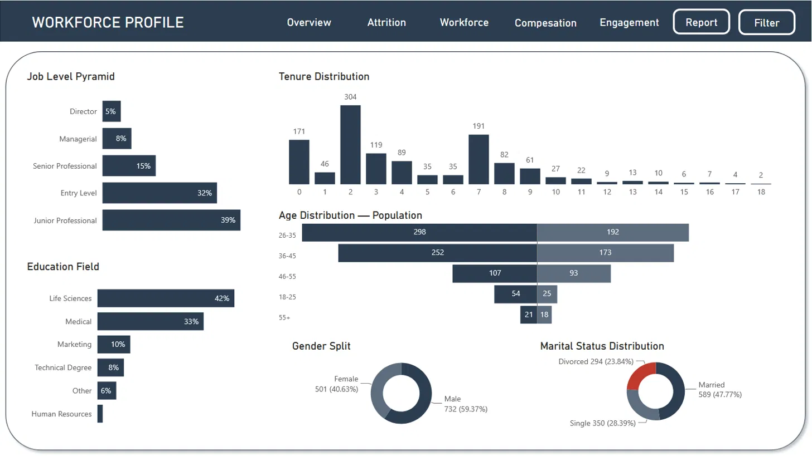
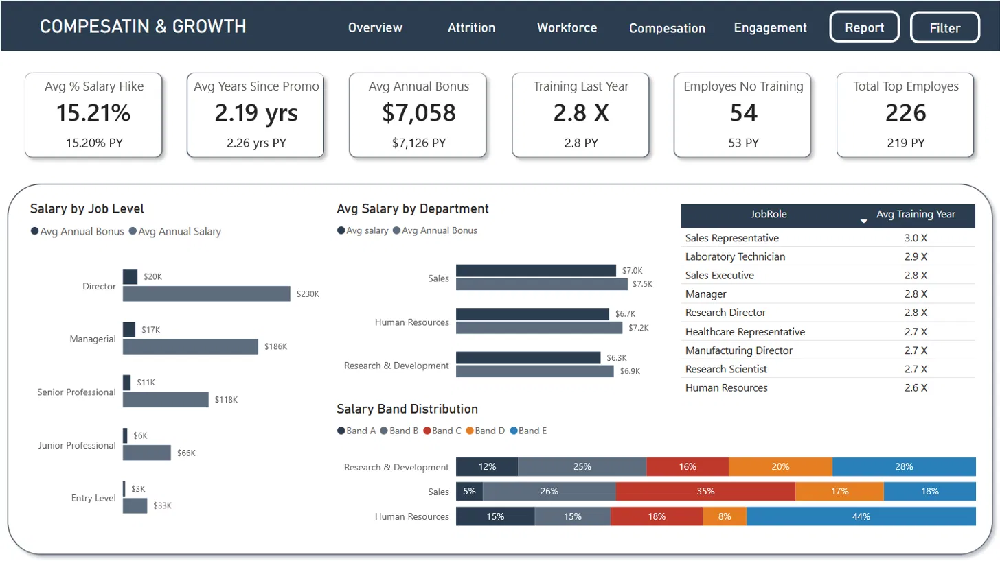
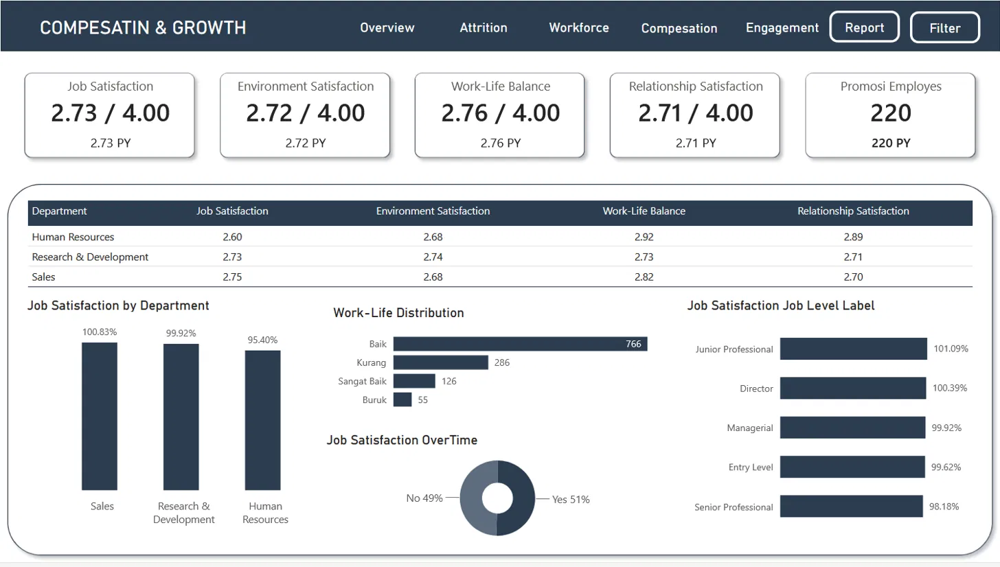


Multi-page Power BI HR analytics dashboard built from employee data of 1,470 total workforce across 3 departments
Covers 5 analytical sections: Executive Overview, Attrition Deep Dive, Workforce Profile, Compensation & Growth, and Employee Engagement

Key Features

- Interactive filter pane with Year and Month slicer for time-based analysis
- Paginated report export functionality for formal HR reporting
- Cross-page navigation menu for seamless tab switching

Dashboard Pages

- Executive Overview — KPI cards (headcount, attrition rate, avg salary, eNPS), department summary tables, satisfaction gauge, demographic distributions
- Attrition Deep Dive — Risk segmentation, attrition by department/age/tenure, heatmap by job level, resign trend over years of service
- Workforce Profile — Job level pyramid, tenure distribution, education field breakdown, gender split, marital status
- Compensation & Growth — Salary by job level and department, salary band distribution, bonus pool, training frequency by role
- Employee Engagement — Satisfaction scores (job, environment, work-life balance, relationship), department-level engagement breakdown, satisfaction trend by job level

Data Highlights

- Attrition rate: 19.22% with Sales as highest-risk department (26%)
- Overall satisfaction score: 2.73 / 4.00
- Average monthly salary: $6,503 with 15.21% annual salary hike
- High-risk attrition employees identified: 28 employees flagged for priority HR intervention

## HR Analytics Dashboard + Monthly Paginated Report (Power BI) UPDATE

A five-page Power BI dashboard for HR analytics, plus a parameter-driven paginated report that produces a monthly HR report in one click. The project covers headcount, attrition, workforce profile, compensation and employee engagement.

> **Data:** public HR sample dataset (IBM-style attrition data). Company name, signatories and document numbers in the paginated report are fictional.

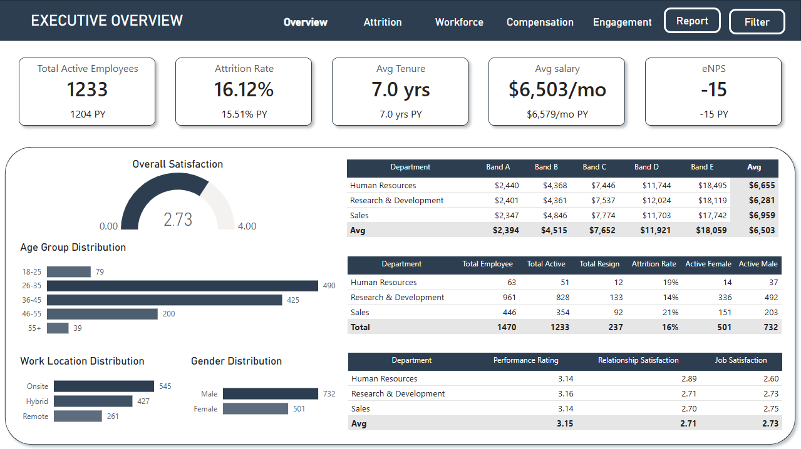

---

### Contents

- [Dashboard pages](#dashboard-pages)
- [Paginated report](#paginated-report)
- [Data model and key measures](#data-model-and-key-measures)
- [What changed in this revision](#what-changed-in-this-revision)
- [Known limitations](#known-limitations)
- [Tools](#tools)

---

### Dashboard pages

| Page | What it answers | Main components |
|---|---|---|
| **Executive Overview** | How big is the workforce, and how healthy is it? | KPI cards with prior-year (PY) comparison: active employees, attrition rate, average tenure, average salary, eNPS. Overall satisfaction gauge. Salary bands by department, headcount and attrition table, rating and satisfaction table, age, location and gender distributions |
| **Attrition Deep Dive** | Who leaves, and where does attrition concentrate? | Total attrition, attrition rate, overtime attrition rate, high-risk role with its rate. Risk level distribution, attrition by department and age group, heatmap by job level and department, attrition by tenure band |
| **Workforce Profile** | Who works here? | Job level pyramid, education field, tenure in current role, age by gender (butterfly chart), gender split, marital status |
| **Compensation & Growth** | Is pay and development fair and competitive? | Salary hike, years since promotion, bonus, training frequency, employees without training, average rating. Salary by job level and department, training by job role, salary band distribution |
| **Engagement** | How do employees feel? | Job, environment, work-life and relationship satisfaction (scale 1–4) with PY, scores by department and job level, work-life distribution, overtime rate, eNPS breakdown (promoter, passive, detractor) |

Navigation: top menu with active-page highlight, a **Report** button to the paginated report, and a **Filter** button that opens a slide-out panel (year, month, department) so the canvas stays clean.

---

### Paginated report

A formal monthly report built in Power BI Report Builder, designed to be sent to stakeholders rather than screenshotted from the dashboard.

- **One parameter, `ReportMonth`,** drives the period label (e.g. *01–31 October 2026*), publish date and document number (e.g. `DOC/HRD/RPT/2026-10`).
- **Structure:** cover page, table of contents, seven sections (headcount, recruitment and movement, compensation and payroll, performance and development, satisfaction and retention, attendance/overtime/work location, attrition risk and follow-up plan) and a created/checked/approved sign-off block.
- **Export:** PDF, Accessible PDF, Word, PowerPoint, Excel, CSV, MHTML and XML.

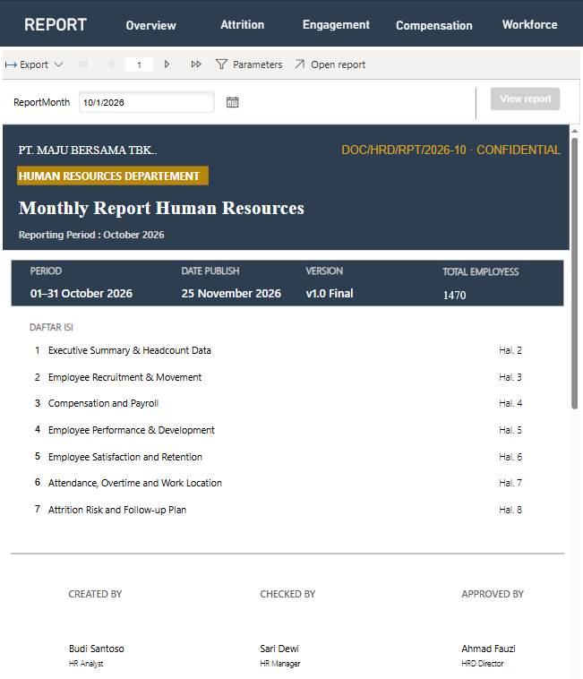

---

### Data model and key measures

The dashboard and the paginated report read from the same semantic model, so numbers match across both.

**Attrition is defined once**, as resigned employees divided by all employees (active plus resigned), and reused on every page and in the PY comparison:

```DAX
Total Employees = DISTINCTCOUNT ( 'Employee'[EmployeeNumber] )

Total Resign =
CALCULATE ( [Total Employees], 'Employee'[Attrition] = "Yes" )

Active Employees =
CALCULATE ( [Total Employees], 'Employee'[Attrition] = "No" )

Attrition Rate = DIVIDE ( [Total Resign], [Total Employees] )
```

> Simplified for illustration. Column and measure names follow the sample dataset and may differ slightly from the .pbix.

**Reconciliation checks used while validating:**

- Department totals add up to headcount (63 + 961 + 446 = 1,470 total, of which 1,233 active and 237 resigned).
- Risk distribution (658 + 466 + 109) equals active employees (1,233).
- Age, gender and work-location charts each add up to the active headcount.
- Overtime rate on the dashboard (23%) matches the paginated report.

---

### What changed in this revision

#### 1. Metric definitions and logic

| Area | Before | After |
|---|---|---|
| **Attrition rate** | Two definitions in the same file: resigned ÷ active on the Overview (19.22%) and resigned ÷ total on the Attrition page (16.12%) | One measure (resigned ÷ total employees) on every page: **16.12%** |
| **Attrition PY** | Overview and Attrition page used different bases (18.36% vs 15.51%) | Same basis on both pages: **15.51% PY** |
| **Department attrition** | Overview 24% / 16% / 26% vs Attrition page 19% / 14% / 21% | Consistent: **19% / 14% / 21%** |
| **HR department** | Showed **400%** attrition when filtered (4 resigned ÷ 1 active) | Rates stay below 100% because the denominator is total employees |
| **"Total Employees"** | Card showed active employees (1,233) under a "total" label | Renamed **Total Active Employees**; table headers say *Active Female / Active Male* |
| **Risk distribution** | 1,119 Medium / 86 Low / 28 High (91% Medium, little signal) | **658 Low / 466 Medium / 109 High**, sums to 1,233 |
| **High-risk role** | Same text repeated as value and PY | Role plus its attrition rate (Sales Representative, **39.76%**) |
| **eNPS** | Label "Ensp", value −0.147 | **eNPS**, shown on the −100 to +100 scale (−15) |

#### 2. Charts and readability

| Area | Before | After |
|---|---|---|
| **Attrition by tenure** | Raw counts by year, spike to 100% at year 40 from a tiny sample | Rate by **tenure bands** (0–1 … 31–40) |
| **Risk heatmap** | Bars without numbers or a legend | Matrix of job level × department with percentages |
| **Job level pyramid** | Sorted by value | Sorted by hierarchy (Director at the top, Entry Level at the bottom) |
| **Age by gender** | No legend, groups sorted by size | Legend added; age groups ordered 18–25 to 55+ |
| **Tenure chart** | Titled "Tenure Distribution", but it measures years in current role | Retitled **Tenure Years Distribution in Current Role** |
| **Satisfaction** | Index values such as 100.83% and 95.40% that read like percentages | Actual scores on the 1–4 scale in department and job-level tables, plus an **Overall Satisfaction** column |
| **Work-life scale** | Mixed Indonesian/English labels sorted by count | **Poor → Very Good**, in English and in logical order |
| **Overtime donut** | "Job Satisfaction OverTime" (51% / 49%), unclear meaning | **Overtime Rate** (23% / 77%) |
| **eNPS** | A single number | Promoter / Passive / Detractor breakdown |
| **Salary charts** | Monthly salary and annual bonus on one axis with no unit labels | Series labelled *(monthly)* and *(annual)* |

#### 3. Labels, navigation and design

| Area | Before | After |
|---|---|---|
| **Typos and naming** | "COMPESATIN & GROWTH" (also used on the Engagement page), "Promosi Employees", "Employes", "Ensp", "Categori" | Corrected page titles and card labels; Engagement page has its own title |
| **Menu** | No indication of the current page | Active page highlighted |
| **Filters** | Basic slicers | Slide-out panel with year, month and department, plus Clear and Close |
| **Salary band colours** | Red, orange and blue with no meaning | Single-hue gradient |
| **Marital status** | Divorced highlighted in red | Neutral greys |
| **Compensation KPI** | "Total Top Employees" with no definition | **Avg Employees Rating** |

#### 4. Paginated report

| Area | Before | After |
|---|---|---|
| **Reporting period** | Header said *Desember 2023* while the period box said *Mei 2025* | Driven by `ReportMonth`; header and period always agree |
| **Document number / publish date** | Hard-coded (`DOC/HRD/RPT/2023-12`) | Generated from the parameter (`DOC/HRD/RPT/2026-10`) |
| **Language** | Mixed Indonesian and English ("Daftar Isi") | Table of contents in English |
| **Generation** | Edit text by hand every month | Pick the month, view the report, export |

---

### Dahboard Update

| | |
|---|---|
| 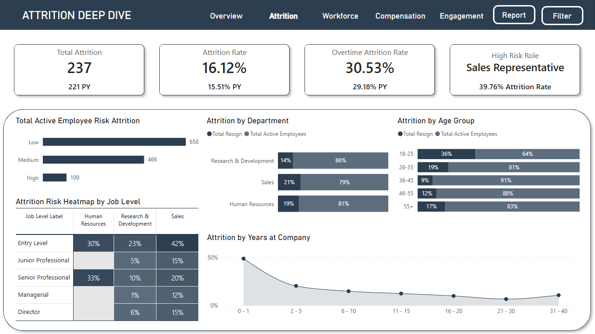 | 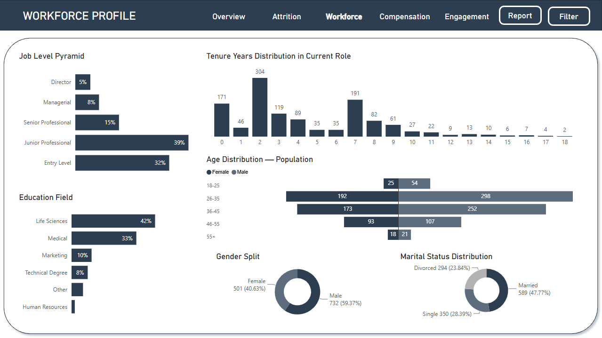 |
| 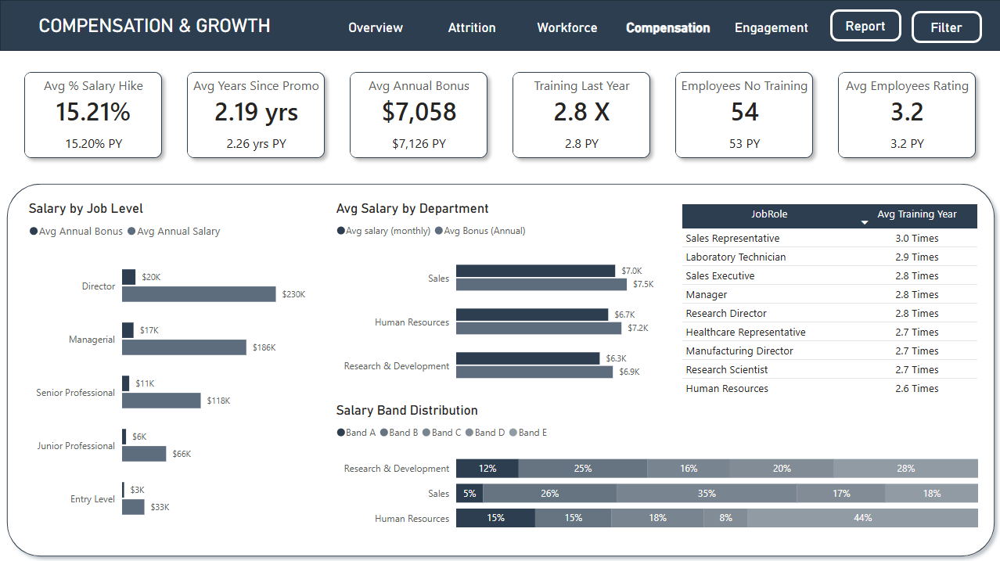 | 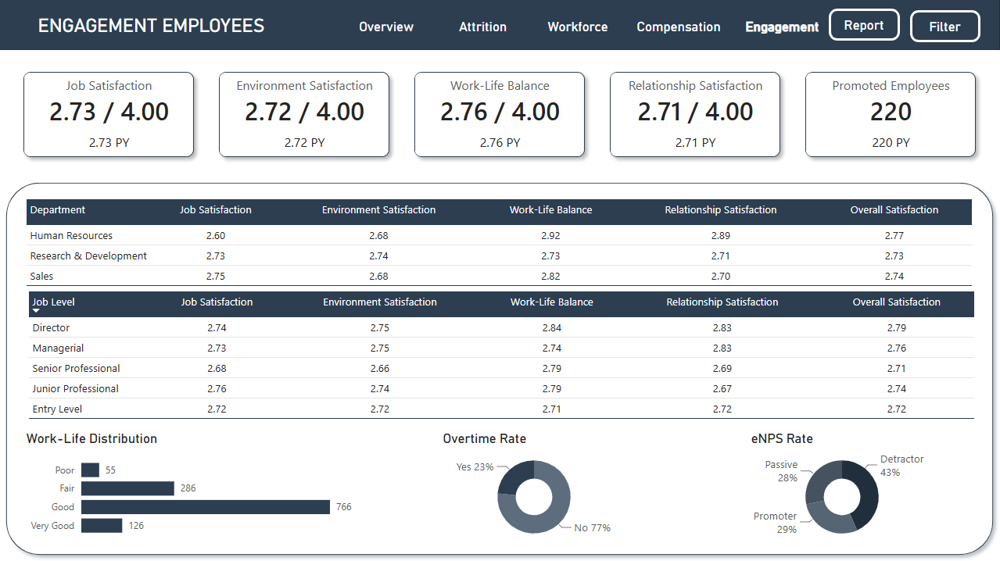 |

---

### Tools

Power BI Desktop, DAX, Power BI Report Builder (paginated report), Power Query.

## Marketing Analytics Dashboard

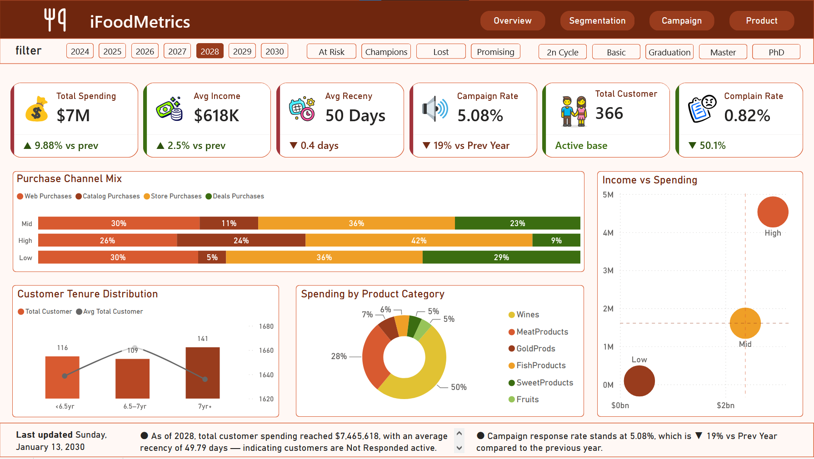
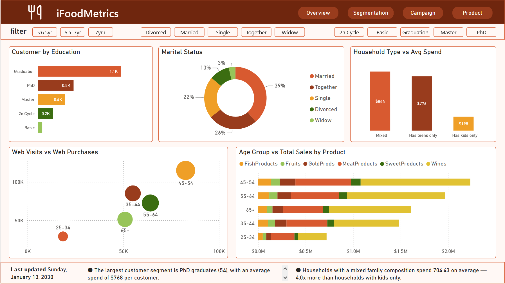
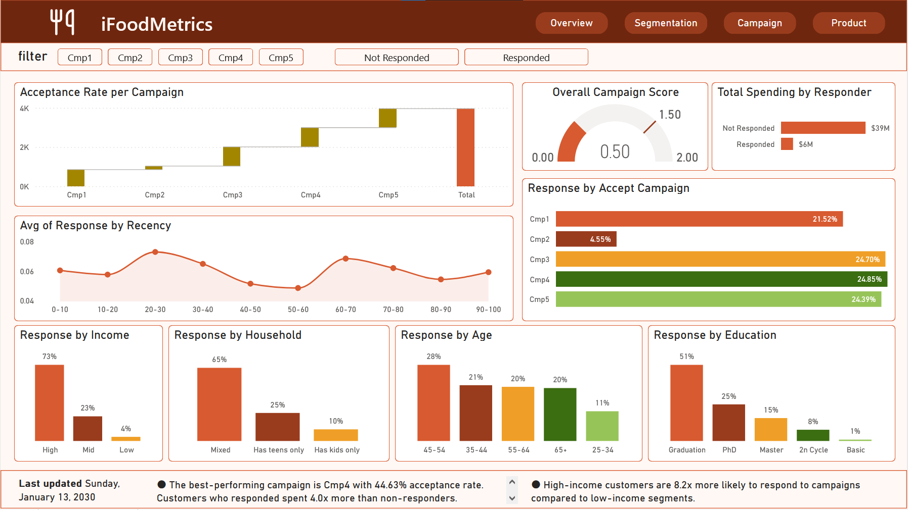
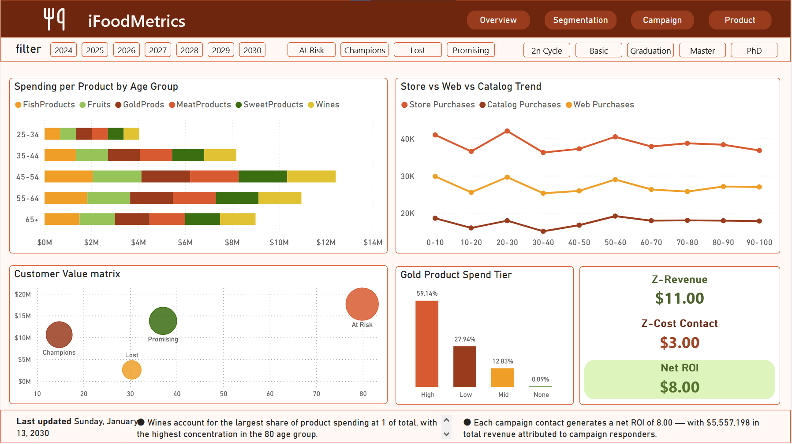

Multi-page Power BI Marketing & Customer Analytics dashboard built from customer purchase behavior data of 366 active customer bases.
Covers 4 analytical sections: Overview, Segmentation, Campaign, and Product.

Key Features

- **Dynamic Customer Cohort Filters:** Interactive slicers for Years (2024–2030), Customer Risk Segments (At Risk, Champions, Lost, Promising), and Education Levels (2n Cycle, Basic, Graduation, Master, PhD).
- **Embedded Automated Insights:** Bottom status bar generating real-time text summaries based on updated date context.
- **Cross-Tab Top Navigation:** Top menu buttons for seamless switching between the 4 analytics pages (Overview, Segmentation, Campaign, Product).

Dashboard Pages

- **Overview** — High-level performance cards (Total Spending, Avg Income, Avg Recency, Campaign Rate, Complain Rate), Purchase Channel Mix comparison, Customer Tenure Distribution, Spending by Product Category pie chart, and Income vs Spending scatter matrix.
- **Segmentation** — Customer demographics analysis including Education level breakdown, Marital Status ratio, Household Type vs Avg Spend analysis, Web Visits vs Web Purchases behavior, and Product Sales distribution across Age Groups.
- **Campaign** — Detailed marketing response metrics featuring Acceptance Rate waterfall chart per campaign, Overall Campaign Score gauge, Total Spending by Responder, Response rate by Recency trend line, and campaign response profile across Income, Household, Age, and Education segments.
- **Product** — Detailed inventory and sales breakdown including Spending per Product by Age Group bar chart, Store vs Web vs Catalog channel purchase trends, Customer Value Matrix, Gold Product Spend Tier distribution, and core unit economics metrics (Z-Revenue, Z-Cost Contact, Net ROI).

Data Highlights & Key Insights

- **Overall Performance (2028 Cohort):** Total spending reached $7M (+9.88% vs prev) with an active base of 366 customers, a minimal complain rate of 0.82% (-50.1%), and an average household income of $618K (+2.5% vs prev).
- **Core Product Champion:** Wines account for the largest share of product spending (50% of total product spending), with the highest concentration observed in the 45–54 age group category.
- **Household Spending Power:** Households with a mixed family composition spend $844 on average—4.2x more than households with kids only ($198 avg spend).
- **Campaign Effectiveness:** Campaign 4 (Cmp4) is the best-performing marketing campaign with a 44.63% acceptance rate (followed closely by Cmp3 and Cmp5). Customers who responded to campaigns spent 4.0x more ($6M) than non-responders ($39M total base but lower per capita spend).
- **High-Value Target Segment:** High-income customers are 8.2x more likely to respond to marketing campaigns compared to low-income segments.
- **Channel Preference Shift:** Web and Store purchases consistently dominate across all customer tiers (Mid, High, Low income), while Catalog purchases remain the lowest performing channel.

# Portofolio 2025

## Google ADS (Google ADS)

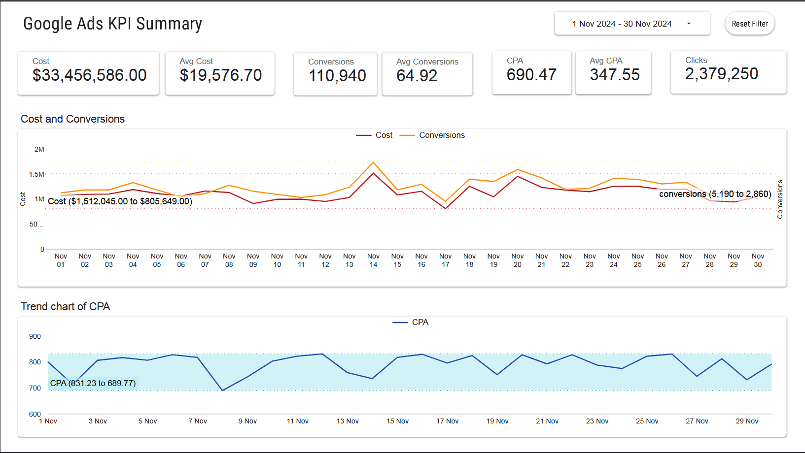
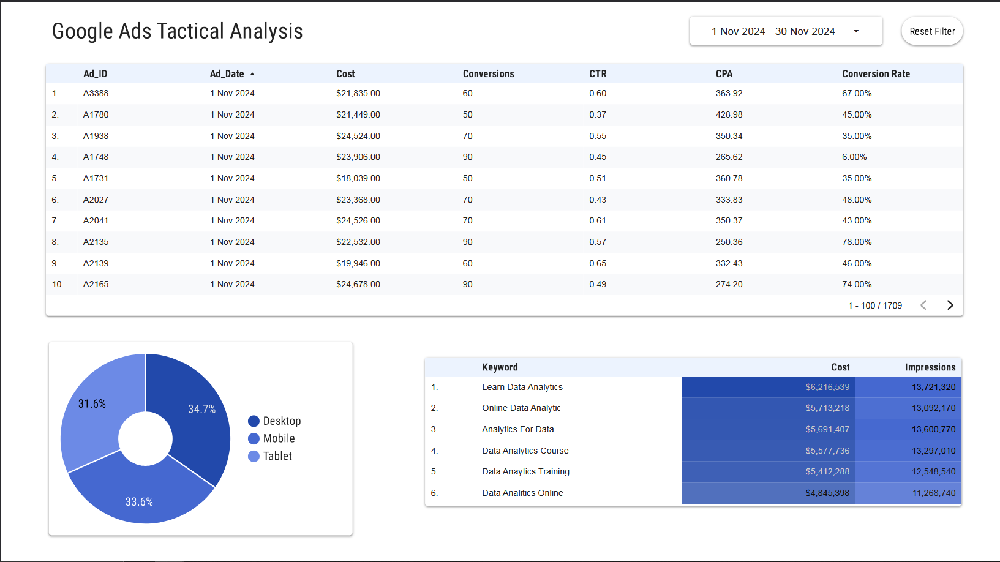

Optimasi Google Ads - November 2024 🚀

Analisis taktis kampanye menunjukkan skala performa masif dengan total biaya $33,4M. Berikut insight utamanya:

  - Efisiensi & Skala: Menghasilkan 110.940 konversi dari 2,37M klik dengan rata-rata CPA sebesar $347,55.
  - Distribusi Perangkat: Performa audiens sangat seimbang di berbagai platform: Desktop (34,7%), Mobile (33,6%), dan Tablet (31,6%).
  - Keyword Jawara: Kata kunci "Learn Data Analytics" menjadi pendorong utama dengan biaya $6,2M dan total 13,7M impresi.
  - Stabilitas Biaya: Tren CPA harian berfluktuasi secara terkendali dalam rentang $689 hingga $831.

Kesimpulan: Strategi ini berhasil menjangkau audiens luas secara merata dengan fokus investasi yang tepat pada kata kunci berperforma tinggi.

## Interactive Pizza Sales Performance & Customer Insight Dashboard (Pizza Analyst)

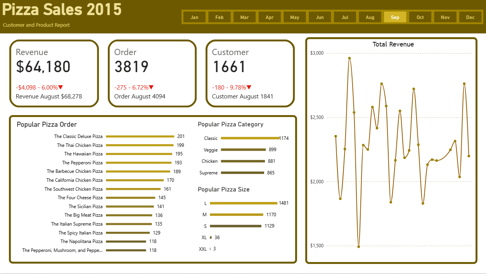
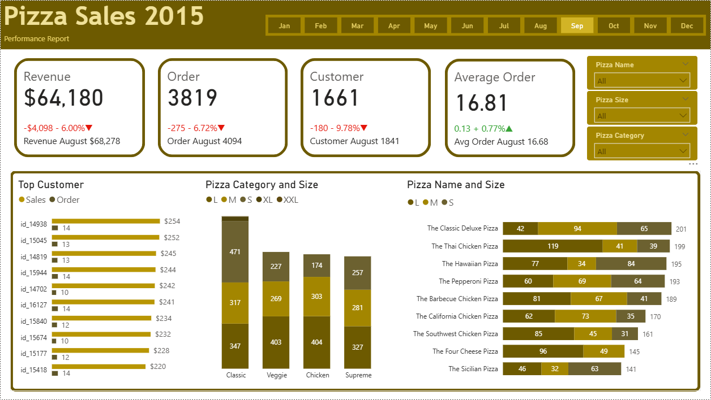

Analisis Penjualan Pizza September 2015 🍕

Performa bulan ini mencatatkan Revenue sebesar $64,180, mengalami penurunan 6% dibandingkan Agustus. Meskipun jumlah pesanan (3,819) dan pelanggan (1,661) berkurang, terdapat sinyal positif pada Average Order yang meningkat menjadi 16.81 (+0.77%).

Insight Utama:

  - Produk Unggulan: "The Classic Deluxe Pizza" menjadi favorit utama dengan 201 pesanan. Kategori Classic mendominasi pasar dengan total 1,174 pesanan.
  - Preferensi Ukuran: Konsumen sangat menyukai ukuran L (Large) yang mencatat 1,481 pesanan, menjadikannya ukuran terpopuler di semua kategori.
  - Loyalitas: Pelanggan dengan ID id_14938 memberikan kontribusi belanja tertinggi senilai $254.

Kesimpulan: Strategi upselling pada ukuran Large dan kategori Classic terbukti efektif menjaga nilai rata-rata pesanan di tengah fluktuasi jumlah pelanggan.

## Interactive Look E-Commerce Performance & Customer Insight Dashboard (Look Ecommece)

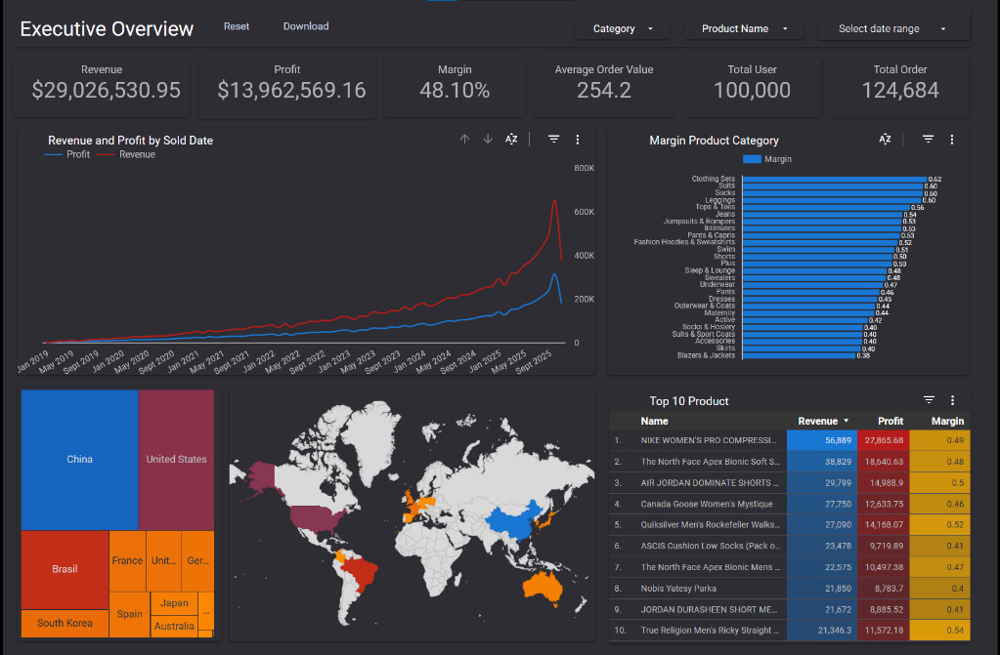
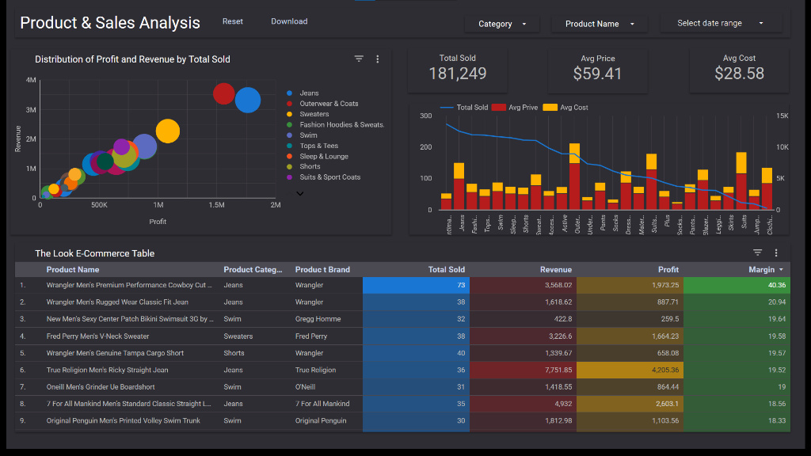
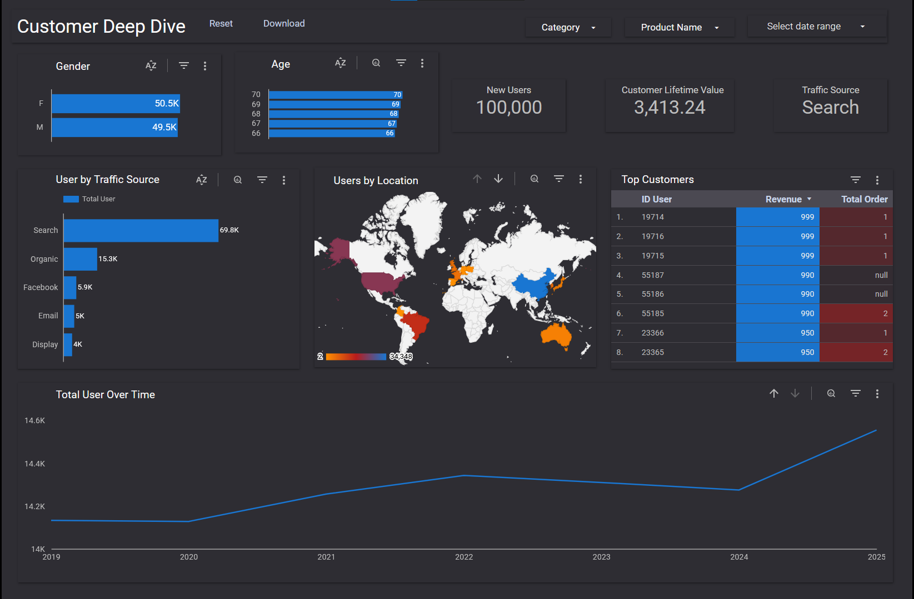
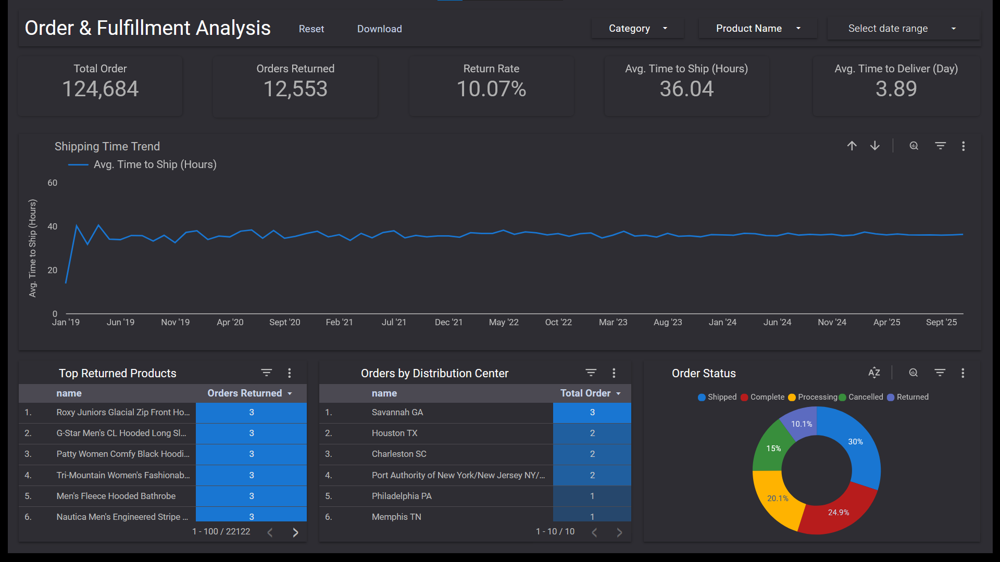

Analisis Strategis E-Commerce: The Look Dashboard 📈

Ringkasan Performa:

  - Financials: Bisnis mencatat pendapatan impresif sebesar $29,02M dengan profit $13,96M, menghasilkan margin sehat di angka 48,10%.
  - Operasional: Total pesanan mencapai 124.684 dengan tingkat pengembalian (Return Rate) sebesar 10,07%.
  - Logistik: Efisiensi pengiriman terjaga dengan rata-rata waktu kirim (Time to Ship) 36,04 jam dan waktu antar (Time to Deliver) 3,89 hari.
  - Status Pesanan: Distribusi status didominasi oleh Shipped (30%) dan Complete (24,9%), namun terdapat angka pembatalan sebesar 15%.

Insight: Meskipun margin keuntungan sangat kuat, optimasi pada pengurangan tingkat pembatalan (15%) dan pengembalian produk (10%) merupakan peluang utama untuk meningkatkan laba bersih lebih lanjut.

## Interactive Executive Business Intelligence & Sales Analytics Suite (sales E-Commmerce)

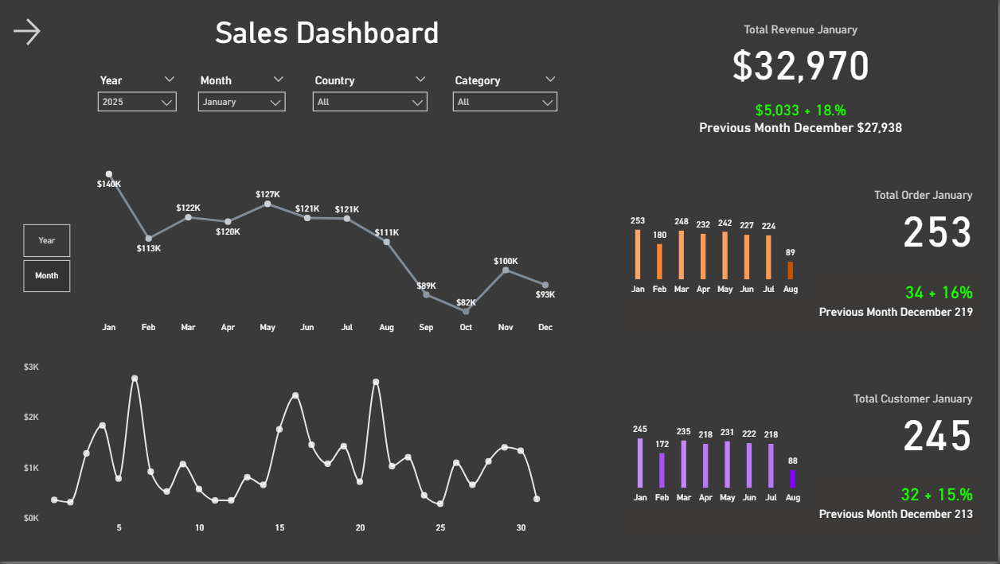
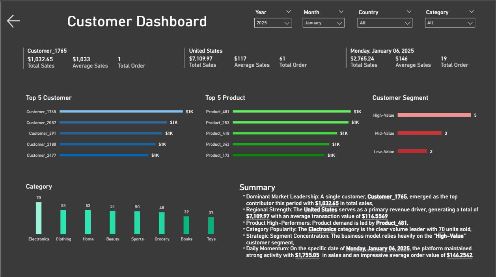

Analisis Performa Awal Tahun - Januari 2025 🚀

Dashboard menunjukkan pertumbuhan dua digit di semua metrik utama. Berikut insight dari data Januari 2025:

  - Pertumbuhan MoM: Revenue mencapai $32,970, naik 18% dibanding Desember. Kenaikan ini sejalan dengan volume pesanan (+16%) dan jumlah pelanggan (+15%).
  - Dominasi Kategori: Electronics menjadi pemimpin volume dengan 70 unit terjual.
  - Driver Utama: Amerika Serikat menjadi motor pendapatan sebesar $7,109.97. Customer_1765 menjadi kontributor tertinggi ($1,032).
  - Strategi Segmen: Bisnis sangat terkonsentrasi pada segmen High-Value (5 pelanggan). Momentum harian puncak terjadi pada 6 Januari dengan penjualan $1,755.

Kesimpulan: Awal tahun yang solid dengan efisiensi transaksi yang terjaga.

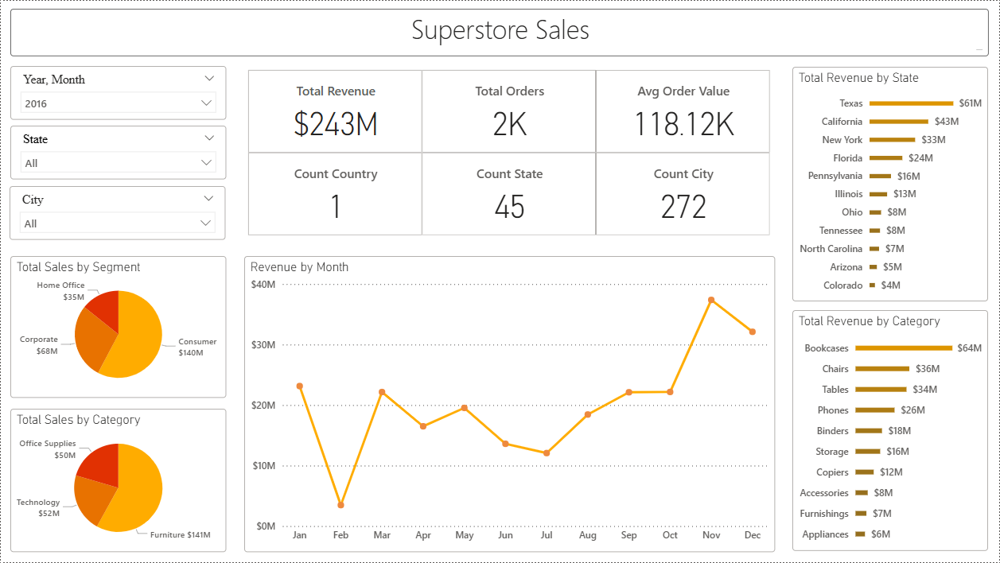
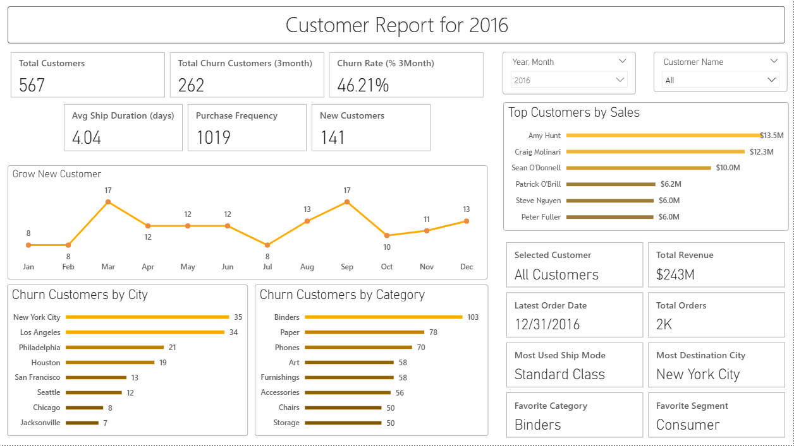

Analisis Superstore Sales 2016 📊

Insight Utama Pada Gambar:

  - Performa Finansial: Total Revenue mencapai $243M dengan rata-rata nilai pesanan $118.12K. Texas ($61M) dan segmen Consumer ($140M) menjadi penopang utama pendapatan.
  - Dominasi Produk: Kategori Furniture memimpin dengan $141M, di mana Bookcases menyumbang $64M. Binders menjadi kategori favorit sekaligus penyumbang churn tertinggi (103 pelanggan).
  - Kesehatan Pelanggan: Bisnis menghadapi tantangan retensi dengan Churn Rate 46.21%. Kehilangan pelanggan terbesar terjadi di New York City (35) dan Los Angeles (34).
  - Fokus VIP: Konsentrasi pendapatan pada pelanggan kunci sangat tinggi, seperti Amy Hunt yang berkontribusi $13.5M.

Kesimpulan: Diperlukan strategi retensi khusus di kota besar untuk menekan churn tanpa mengganggu pertumbuhan masif di sektor Furniture.

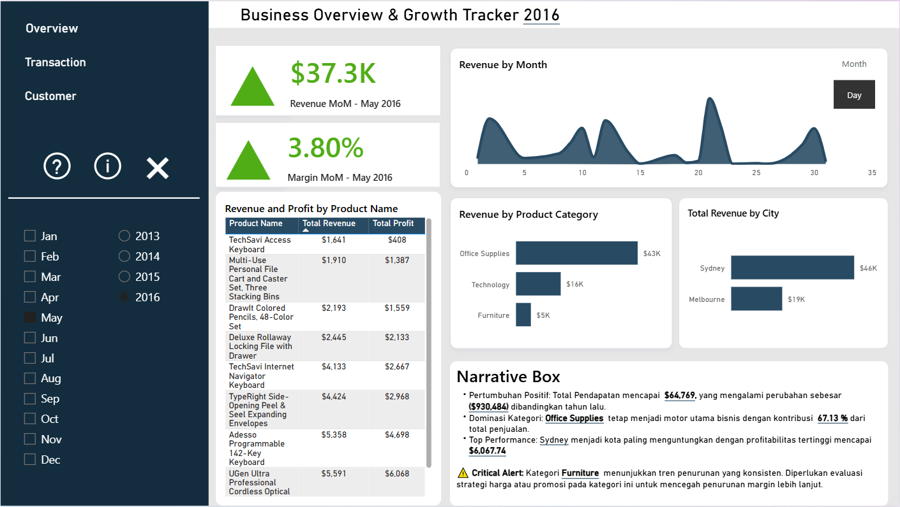
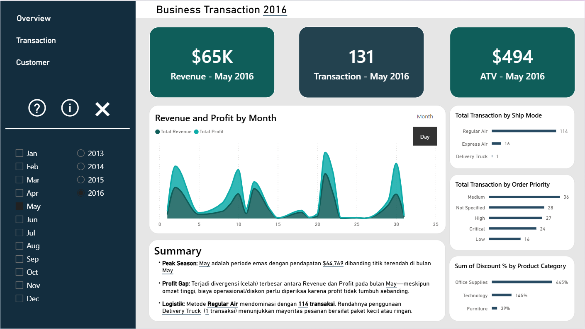
Analisis Performa Bisnis - Mei 2016 📊

Dashboard menunjukkan tren positif dengan kenaikan Revenue MoM sebesar $37.3K dan Margin tumbuh 3.80%. Berikut insight utamanya:

  - Performa: Total pendapatan mencapai $64,769 dengan Sydney sebagai kota paling menguntungkan dengan profit $6,067.74.
  - Dominasi: Office Supplies menyumbang 67.13% pendapatan, namun mencatat total diskon tinggi (445%) yang memicu "Profit Gap" atau ketidakseimbangan antara omzet dan laba.
  - Logistik: Tercatat 131 transaksi dengan ATV $494. Metode Regular Air mendominasi dengan 114 transaksi.
  - Alert: Kategori Furniture menunjukkan tren penurunan konsisten, memerlukan evaluasi strategi harga segera.

Kesimpulan: Pertumbuhan volume harus diimbangi efisiensi diskon untuk menjaga profitabilitas.

## Interactive Executive Business Intelligence & Advanced Sales Analytics Suite (Sales Report)

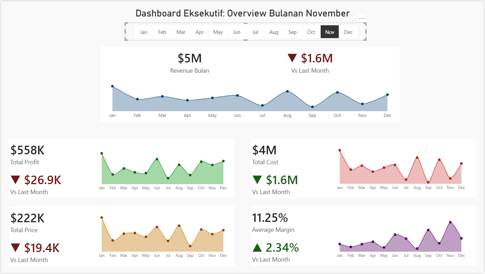
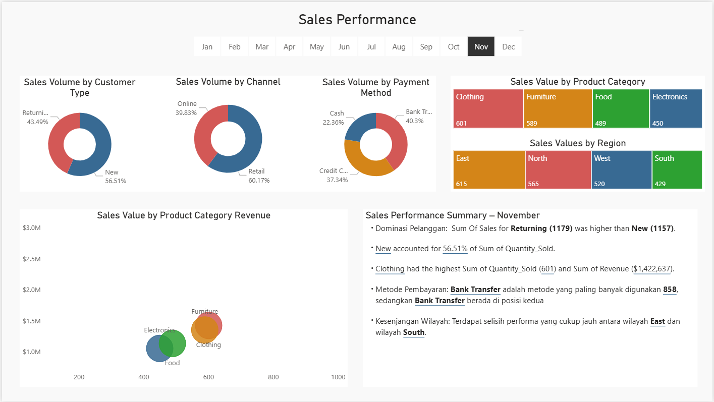

Analisis Performa Eksekutif & Penjualan - November 2016 📊

Meskipun Revenue bulan ini mencapai $5M (turun $1.6M MoM), terdapat peningkatan efisiensi operasional yang signifikan. Berikut insight utamanya:

  - Peningkatan Margin: Average Margin naik 2.34% menjadi 11.25%, menunjukkan kontrol biaya yang lebih baik meskipun volume pendapatan menurun.
  - Dominasi Produk: Kategori Clothing menjadi kontributor terbesar dengan pendapatan $1,422,637 dan volume penjualan tertinggi (601 unit).
  - Perilaku Pelanggan: Pelanggan Returning (1,179) menghasilkan nilai penjualan lebih tinggi dibandingkan pelanggan baru, mempertegas pentingnya strategi retensi.
  - Kanal & Pembayaran: Penjualan Retail mendominasi (60.17%) dengan Bank Transfer sebagai metode pembayaran terfavorit (858 transaksi).
  - Geografis: Wilayah East memimpin performa penjualan, sementara wilayah South memerlukan perhatian khusus karena selisih performa yang cukup jauh.

Kesimpulan: Fokus pada kategori profitabel dan efisiensi biaya berhasil menjaga kesehatan margin di tengah fluktuasi pasar.

## Interactive Multi-Industry BI Dashboards & Executive Analytics (Brazzilan E-Commerce)

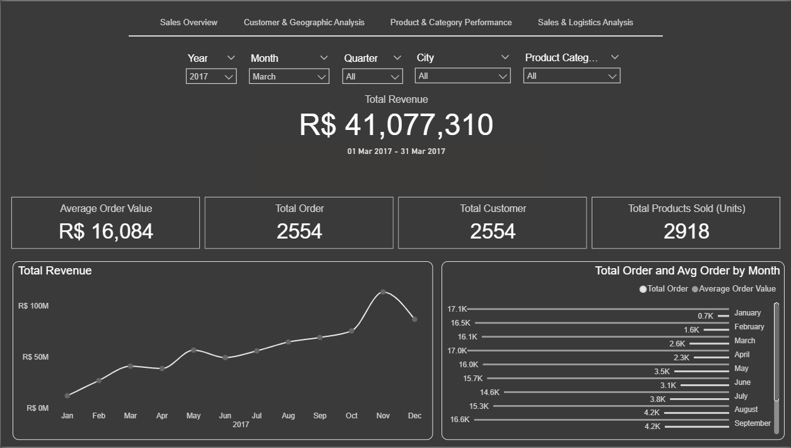
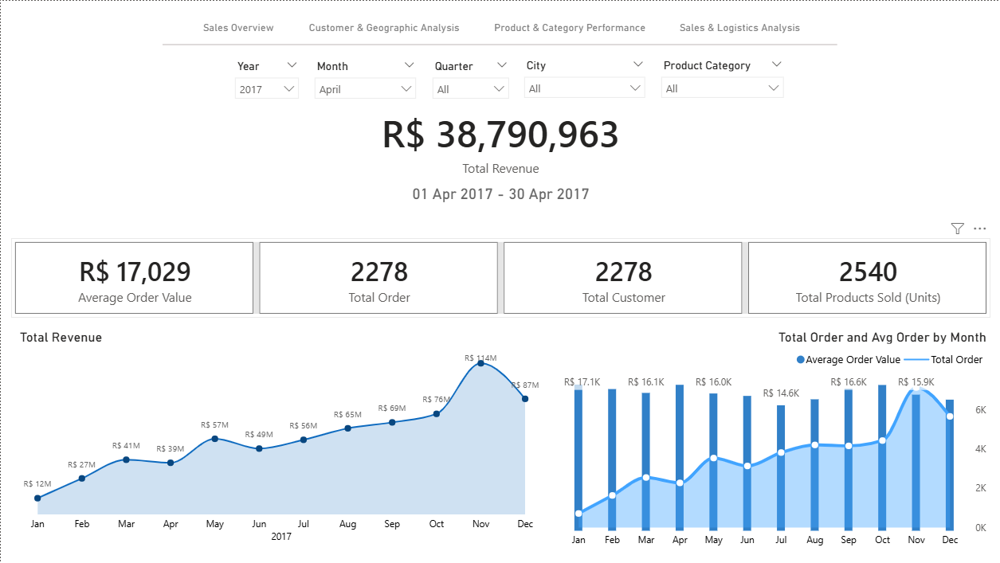

Overview: I developed a high-end Business Intelligence suite designed to transform fragmented raw data into strategic executive insights. This portfolio showcases versatility in design (Modern Dark Mode vs. Professional Light Mode) and depth in analytical modeling across Retail, E-commerce, and F&B sectors.

Key Analytical Pillars:
  - Strategic Sales & Growth: Managed datasets tracking up to $243M in revenue, featuring year-over-year growth metrics (e.g., +18.1% revenue increase) and monthly trend forecasting.
  - Customer Intelligence & Retention: Developed advanced churn analysis (identifying a 46.21% churn rate) and customer segmentation (High-Value vs. Low-Value).
  - Geographic & Logistics Analysis: Mapped sales performance across 272 cities and tracked shipping efficiency (average duration of 4.04 days).
  - Niche Industry Deep-Dives: Tailored dashboards for specific sectors like Pizza Retail, tracking 3,819 total orders and product-size correlations, as well as E-commerce ID-level tracking with review scores.

The Solution: My dashboards empower stakeholders with interactive filtering by Year, Month, Country, and Category, enabling localized decision-making and inventory optimization.


